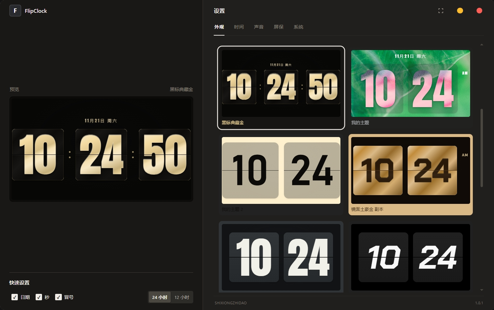
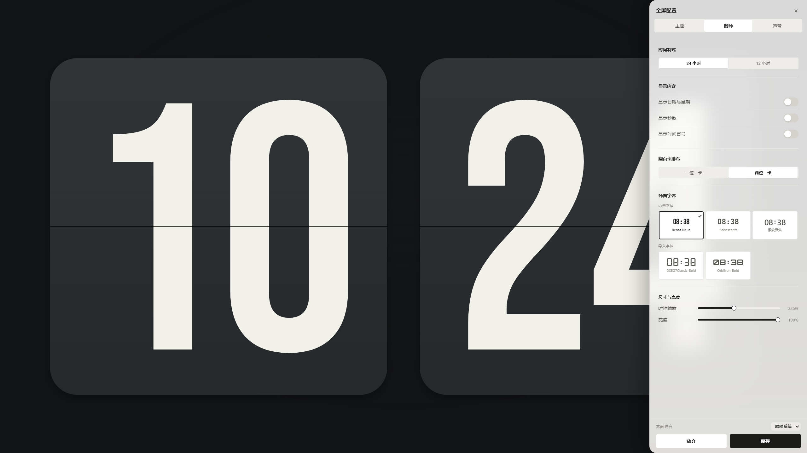
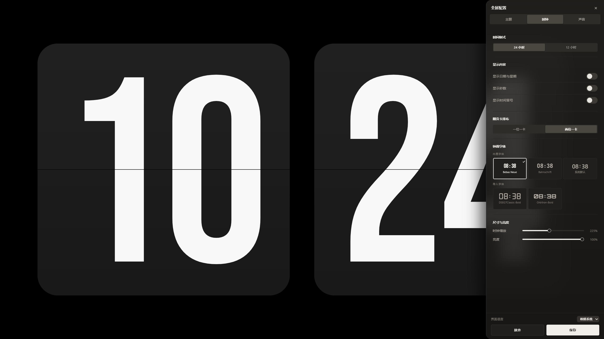

<p align="center"></p>
<h1 align="center">FlipClock</h1>
<p align="center"><em>A mechanical flip clock for your desktop — and a real Windows screen saver.</em></p>
<p align="center"><strong>English</strong> · <a href="https://github.com/ShiXiongZhiDao/FlipClock/blob/main/README.zh.md">简体中文</a></p>
<p align="center">
  
  
  
  
  
</p>

<p align="center"></p>

## What it does

FlipClock turns a Windows desktop into a mechanical split-flap clock, with the flip animation and its click generated at runtime — no audio files to ship.

- **Themes** — five built-in themes; six parts such as background, card, and digits with selectable materials and colours, plus custom images. Each theme carries its own clock profile, so switching themes switches the whole clock face.
- **Clock face** — one or two digits per card, 24/12-hour time, optional date, seconds, and separator dots; adjustable scale, brightness, and digit font. Import local fonts (ttf / otf / woff / woff2) for the digits; files are copied into the configuration directory.
- **Editing** — double-click the clock to open full-screen setup: change settings in a drawer while watching the result. Save writes once; Discard rolls everything back.
- **Window** — two-column Settings with a live preview and five tabs. Interface language and UI appearance (system / light / dark) are selectable; appearance changes only the shell, never the clock face.
- **Config bundle** — export themes, fonts, and preferences from **System**, then choose what to restore on import. Custom themes and fonts are merged, never deleted.
- **Running** — system tray, autostart, primary or all monitors. The same binary is also a registerable `.scr` screen saver, installed per user without administrator rights.

<p align="center"></p>

## What it is not

- **Not a web page.** It is a native Windows app; the clock UI runs locally in WebView2.
- **Not an alarm, timer, or calendar.** It tells the time and, optionally, the date. Nothing rings.
- **Not a replacement for the Windows lock screen.** It is a screensaver you choose in the Windows dialog, plus a full-screen mode you start yourself.
- **Not a cloud service.** There is no account, no sync, and no cloud storage.
- **Not cross-platform.** Windows 10/11 x64 only. The Windows system-preview hook (`/p <HWND>`) is intentionally unsupported: the process exits without creating a window.

## Why this exists

A split-flap clock is nice to look at, but most desktop versions are either a browser tab (gone when the browser closes) or a screensaver with no settings. This one is built to be both: the same binary runs as a normal app and as a genuine `.scr` registered with Windows. The flip sound is generated with the Web Audio API, so the download stays small and nothing is fetched at runtime. All appearance choices live in one Settings window and take effect immediately.

## Compared with the usual ways

| | Windows built-in screensaver | A clock website | FlipClock |
| --- | --- | --- | --- |
| Runs when Windows locks the screen | Yes | No | Yes, as a real `.scr` |
| Needs a browser or a tab | No | Yes | No |
| Mechanical flip animation | No | Sometimes | Yes, four-layer CSS 3D leaves |
| Flip sound | No | Usually muted | Synthesised on each displayed change |
| Themes, digit layout, fonts, brightness | No | Varies | Yes, all in Settings |
| Works offline | Yes | Usually no | Yes, except the optional update check |
| Needs administrator rights | No | No | No — installed per user |

## Screenshots

The two full-screen images above show the classic dark theme with two digits per card, and the Black Label Gold theme with seconds and date. The interface language can follow the system or be set to Chinese or English; the five images below show the Chinese UI. The top row is the Settings window in light and dark, the middle row is the **Time** tab of the full-screen setup drawer in light and dark, and the last one is a custom theme combining a background image with a digit texture. UI appearance never touches the clock face — that is decided by the theme.

| Settings · light UI | Settings · dark UI |
| --- | --- |
|  |  |

| Full-screen setup · light drawer | Full-screen setup · dark drawer |
| --- | --- |
|  |  |

<p align="center"></p>

## Privacy and boundaries

- No personal information is collected.
- No access to the camera, microphone, file contents, or clipboard.

## How to install

Download a release from <https://github.com/ShiXiongZhiDao/FlipClock/releases>.

- **Installed build** — `FlipClock_<version>_x64-setup.exe`. Installs for the current user; no administrator rights required. Open **System → About** in the app to check for and install updates.
- **Portable build** — `FlipClock_<version>_x64-portable.zip`. Unzip and run. It can check for updates but has no installer to run them, so new versions must be downloaded manually.
- **Gitee mirror** — <https://gitee.com/ShiXiongZhiDao/FlipClock/releases> carries the same release assets.

To use it as a screen saver, open Settings → **Screen Saver** → *Install and set as current screen saver*. The component is copied next to the app and registered for the current user. You can always restore your previous screen saver from the same page.

Command line:

| Argument | Effect |
| --- | --- |
| *(none)* | Follows the no-argument policy in Settings (Settings window or full-screen clock). |
| `/c` | Open the Settings window. |
| `/s` | Start the screen saver; any input exits it. |
| `/p <HWND>` | Not supported — the process exits without creating a window. |

## FAQ

**Is the `.scr` really the same program?**
Yes. `FlipClock.scr` and `FlipClock.exe` are byte-identical copies; only the file name differs. Windows decides how to launch it from the extension and the arguments.

**Do I need administrator rights?**
No. The screensaver component and the autostart entry are both registered under the current user's registry hive.

**Why did I get a "version mismatch" message on the Screen Saver page?**
The registered `.scr` is older than the app you are running. Click *Reinstall screen saver component* to replace it with the matching binary.

**I closed the window but the tray icon is still there. Is it stuck?**
No. Closing the Settings window hides it to the tray by default. Left-click the tray icon to reopen it, or right-click → *Quit* to exit. You can turn this behaviour off in Settings → System.

**Can I use it on more than one monitor?**
Yes. Settings → Screen Saver offers *Primary monitor* and *All monitors*. A specific subset of monitors is not supported yet.

**Does 12-hour mode show `9` or `09`?**
`09`. Both 12-hour and 24-hour modes zero-pad the hour, so the two digit layouts stay symmetrical.

**Does autostart open a big clock over my desktop at login?**
No. Autostart launches the app with `--tray`, which only puts an icon in the tray. The status is read from the registry each time, so disabling it in Task Manager is reflected in Settings.

**What happens if I launch FlipClock again while it is already running?**
The existing window is brought forward; no second background instance is created. Screen saver (`/s`) launches are exempt so Windows can always start one.

**Why does the clock get clipped at large scale?**
Clock scale goes up to 450% by design. Above a certain size the cards extend past the screen edge rather than being silently shrunk, so what you see in the preview is what you get.

**What is the difference between UI appearance and a theme?**
UI appearance changes only the light/dark look of the Settings window and the full-screen setup drawer. The clock face is decided by the theme.

**Will a custom theme break if I move its images?**
No. Images are copied into the configuration directory when you pick them, so moving or deleting the originals does not affect the theme.

**What happens if I delete an imported font file?**
Nothing — the font is copied into the configuration directory. But if you remove the font inside the app, themes using it fall back to Bebas Neue.

**How do I take my themes and fonts to another machine?**
Export a config bundle from **System**, then import it on the other machine and select what to restore. Custom themes and fonts are merged rather than overwriting what is already there; built-in clock profiles and the preferences you select do overwrite their counterparts.

## Build from source

You need Windows 10/11 with WebView2, Node.js 18+, pnpm, and a stable Rust toolchain.

```bash
pnpm install
pnpm build          # type-check and build the frontend
pnpm tauri dev      # development
pnpm build:app      # release build, frontend embedded in the binary
pnpm scr            # copy the release binary to dist-scr/FlipClock.exe and .scr
```

Do **not** use a bare `cargo build --release`: without the `custom-protocol` feature the frontend is not embedded, and the app will only show a "localhost refused connection" page. Building an installer additionally requires `TAURI_SIGNING_PRIVATE_KEY`, because update packages must be signed.

See [CHANGELOG.md](./CHANGELOG.md) for what changed between releases, and [THIRD_PARTY_NOTICES.md](./THIRD_PARTY_NOTICES.md) for dependency and font attribution.

## License

GNU General Public License v3.0 — see [LICENSE](./LICENSE). The bundled Bebas Neue font is distributed under the SIL Open Font License; see `src/assets/fonts/OFL.txt` and [THIRD_PARTY_NOTICES.md](./THIRD_PARTY_NOTICES.md).

## ☕ Support the author

If FlipClock made your desktop a little nicer, you can buy the author a coffee — projects like this
live on that. The QR codes below are loaded from a public image repository, not bundled with the app.

| Alipay | WeChat Pay |
| --- | --- |
|  |  |

## 📮 Contact

- Website: [shixiongzhidao.cn](https://shixiongzhidao.cn)
- Open-source projects: [github.com/ShiXiongZhiDao](https://github.com/ShiXiongZhiDao)
- Issues: [GitHub Issues](https://github.com/ShiXiongZhiDao/FlipClock/issues)
- WeChat channel: **师兄知道** — the same one shown in the app's *System → About* screen.


