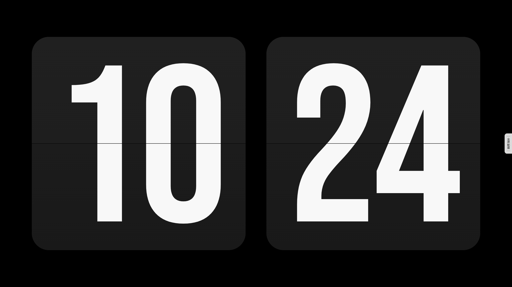
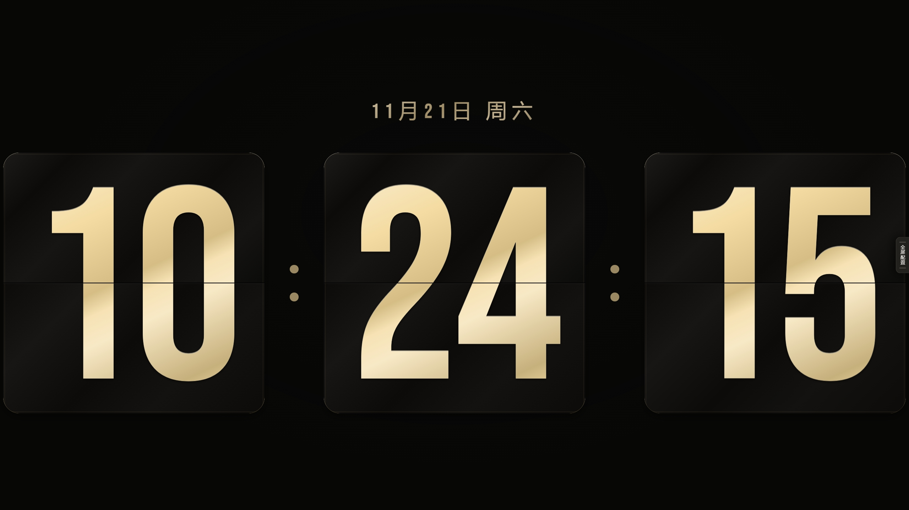
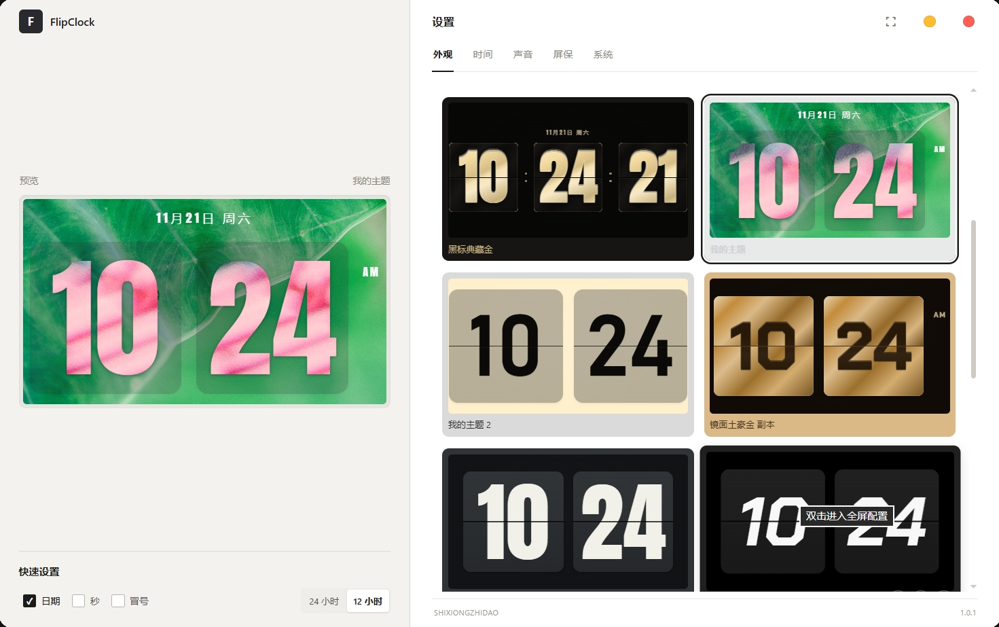

<p align="center"></p>
<h1 align="center">FlipClock</h1>
<p align="center"><em>A mechanical flip clock for your desktop — and a real Windows screen saver.</em></p>
<p align="center"><strong>English</strong> · <a href="https://github.com/ShiXiongZhiDao/FlipClock/blob/main/README.zh.md">简体中文</a></p>
<p align="center">
  
  
  
  
  
</p>

<p align="center"></p>

## Download

Windows 10/11 x64. Pick one:

| Build | File | Notes |
| --- | --- | --- |
| Installed | [`FlipClock_1.1.1_x64-setup.exe`](https://github.com/ShiXiongZhiDao/FlipClock/releases/download/v1.1.1/FlipClock_1.1.1_x64-setup.exe) | Per-user install; no administrator rights; in-app updates |
| Portable | [`FlipClock_1.1.1_x64-portable.zip`](https://github.com/ShiXiongZhiDao/FlipClock/releases/download/v1.1.1/FlipClock_1.1.1_x64-portable.zip) | Unzip and run; updates must be downloaded manually |

[GitHub Releases](https://github.com/ShiXiongZhiDao/FlipClock/releases) ·
[Gitee mirror](https://gitee.com/ShiXiongZhiDao/FlipClock/releases)

WebView2 is included with Windows 10/11. If it is missing, the installer fetches it.

## What it is

FlipClock is a mechanical split-flap clock for the Windows desktop **and** a real `.scr`
screen saver registered with Windows — the same binary does both. The flip animation and
its click are generated at runtime, so there are no audio files to ship.

## Highlights

- **Themes** — five built-in themes, each carrying its own clock profile; custom themes
  built from six parts with matte, metallic, or soft materials, plus background and digit images.
- **Clock face** — one or two digits per card, 24/12-hour time, optional date, seconds, and
  separator dots; adjustable scale, brightness, and clock font.
- **Editing** — double-click the clock for full-screen setup: change values in a drawer while
  watching the result. Save writes once; Discard rolls everything back.
- **Window** — two-column Settings with a live preview. Interface language and UI appearance
  (system / light / dark) are separate from the clock face.
- **Config bundle** — export themes, fonts, and preferences from **System**, then choose what
  to restore on import. Custom themes and fonts are merged, never deleted.
- **Running** — system tray, autostart, primary or all monitors. The same binary registers
  as a per-user `.scr` without administrator rights.

## Screenshots

Black Label Gold with seconds and date; a custom theme combining a background image with a
digit texture; the Settings window; and the full-screen setup drawer.

<p align="center"></p>
<p align="center"></p>

| Settings · light UI | Settings · dark UI |
| --- | --- |
|  |  |

| Full-screen setup · light drawer | Full-screen setup · dark drawer |
| --- | --- |
|  |  |

The interface language can follow the system or be set to Chinese or English; these UI
screenshots show Chinese. UI appearance never touches the clock face — the theme decides that.

## Quick start

1. **Install** — run the setup (or unzip the portable build) and open FlipClock.
2. **Make it yours** — in Settings, pick a theme under **Appearance**, then set time format,
   date, seconds, and digit layout under **Time & Date**. Changes save as you go.
3. **Use it as a screen saver** — **Settings → Saver → Install Screen Saver**, then set
   the wait time in Windows.

Closing the Settings window closes it and keeps the app in the tray by default; right-click
the tray icon → **Quit** to exit.

Full steps: [Quick start](./docs/guide/en/quick-start.md) ·
[Screen saver](./docs/guide/en/screensaver.md).

## Requirements and limits

- **Windows 10/11 x64 only.** No macOS, Linux, or Windows ARM build.
- **WebView2 required.** It ships with Windows 10/11; the installer fetches it if missing.
- **No administrator rights.** The app installs per user in `%LOCALAPPDATA%\FlipClock`, and
  the screen saver registers under the current user.
- **Monitors:** the screen saver covers the primary monitor or all monitors. A specific
  subset is not supported.
- **System preview:** the `/p <HWND>` hook is not supported; the process exits without
  creating a window.
- **Not a lock-screen replacement, alarm, timer, calendar, or cloud service.** There is no
  account and no sync.
- **The portable build cannot update in place.** Download the new zip.

## Privacy

- **No personal data.** No account, no name or email, no device or installation ID, and no
  access to your files, clipboard, camera, or microphone.
- **Anonymous usage analytics.** Official builds send five anonymous events (app start,
  configuration snapshot, Settings opened, feature toggled, update check) to Aptabase. No
  free text, no persisted identifier, no in-app switch. Builds from source without the app
  key send nothing.
- **Network requests.** An update check is attempted after the Settings window opens, and
  the About section loads three images. There is no sync.
- **Local data.** Settings, themes, fonts, and imported images stay in
  `%APPDATA%\com.dd.shixiongzhidao\`; imported files are copied there.

Full details: [Privacy](./docs/guide/en/privacy.md).

## FAQ and documentation

**Is the `.scr` really the same program?**
Yes. `FlipClock.scr` and `FlipClock.exe` are byte-identical copies; Windows decides how to
launch it from the extension and the arguments.

**Do I need administrator rights?**
No. The screen saver and the autostart entry are both registered under the current user.

**I closed the window but the tray icon is still there. Is it stuck?**
No. Closing the Settings window closes it and keeps the app in the tray by default. Right-click
the icon → *Quit* to exit, or turn this off in System → Startup & Window.

**Why does the Saver page say "Update Needed"?**
The registered `.scr` is older than the app you are running. Close any running saver, then
click *Update Screen Saver*; the update also turns the Windows screen saver back on.

**How do I move my themes and fonts to another machine?**
Export a config bundle from **System**, then import it on the other machine and select what
to restore. Custom themes and fonts are merged; preferences overwrite.

Guides: [Quick start](./docs/guide/en/quick-start.md) ·
[Screen saver](./docs/guide/en/screensaver.md) ·
[Themes and fonts](./docs/guide/en/themes-and-fonts.md) ·
[Backup and restore](./docs/guide/en/backup-and-restore.md) ·
[Privacy](./docs/guide/en/privacy.md) ·
[Troubleshooting](./docs/guide/en/troubleshooting.md) ·
[All guides](./docs/guide/en/README.md).

## Build from source

You need Windows 10/11 with WebView2, Node.js 18+, pnpm, and a stable Rust toolchain.

```bash
pnpm install
pnpm build          # type-check and build the frontend
pnpm tauri dev      # development
pnpm build:app      # release build, frontend embedded in the binary
pnpm scr            # copy the release binary to dist-scr/FlipClock.exe and .scr
```

Do **not** use a bare `cargo build --release`: without the `custom-protocol` feature the
frontend is not embedded, and the app will only show a "localhost refused connection" page.
Building an installer additionally requires `TAURI_SIGNING_PRIVATE_KEY`, because update
packages must be signed.

## License and credits

GNU General Public License v3.0 — see [LICENSE](./LICENSE). The bundled Bebas Neue font is
distributed under the SIL Open Font License; see `src/assets/fonts/OFL.txt` and
[THIRD_PARTY_NOTICES.md](./THIRD_PARTY_NOTICES.md) for font and dependency attribution.

## ☕ Support the author

If FlipClock made your desktop a little nicer, you can buy the author a coffee — projects
like this live on that. The QR codes below are loaded from a public image repository, not
bundled with the app.

| Alipay | WeChat Pay |
| --- | --- |
|  |  |

## 📮 Contact

- Website: [shixiongzhidao.cn](https://shixiongzhidao.cn)
- Open-source projects: [github.com/ShiXiongZhiDao](https://github.com/ShiXiongZhiDao)
- Issues: [GitHub Issues](https://github.com/ShiXiongZhiDao/FlipClock/issues)
- WeChat channel: **师兄知道** — the same one shown in the app's *System → About* screen.


