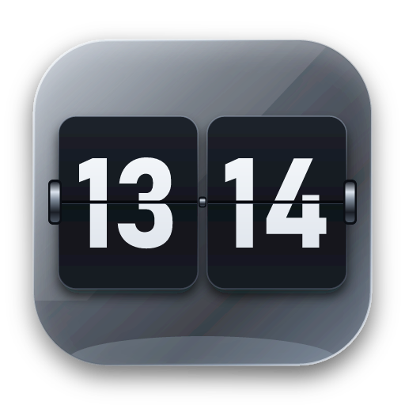
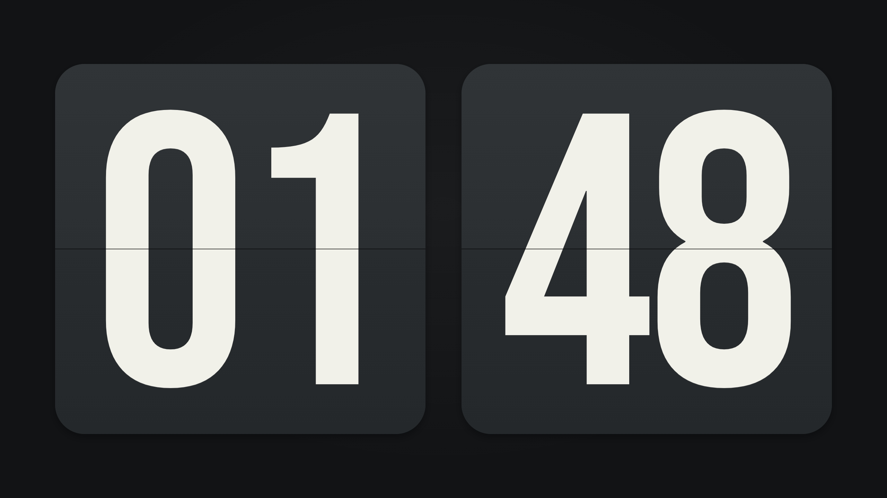
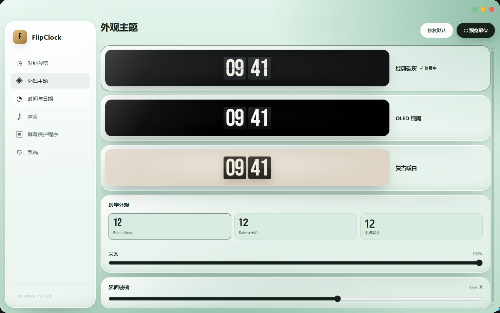
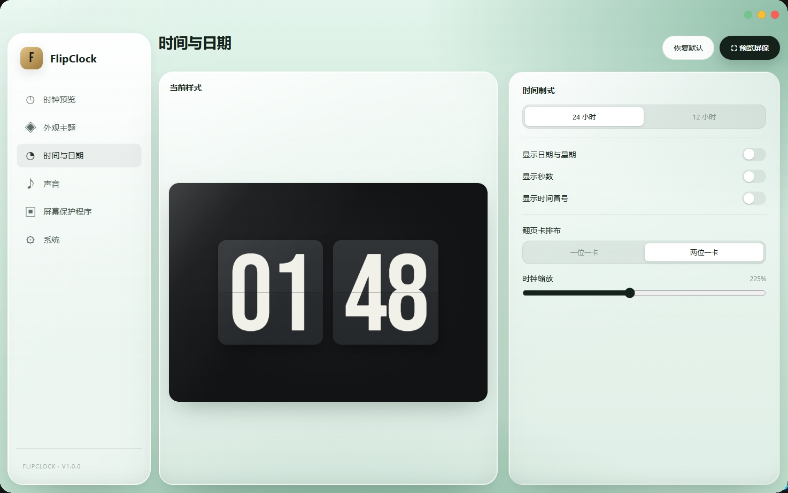

<p align="center"></p>
<h1 align="center">FlipClock</h1>
<p align="center"><em>A mechanical flip clock for your desktop — and a real Windows screen saver.</em></p>
<p align="center"><strong>English</strong> · <a href="https://github.com/ShiXiongZhiDao/FlipClock/blob/main/README.zh.md">简体中文</a></p>
<p align="center">
  
  
  
  
  
</p>

<p align="center"></p>

## What it does

FlipClock turns a Windows desktop into a mechanical split-flap clock. Each digit sits in a flip card with a centre seam: the upper leaf folds down, the lower leaf flips in, and a short mechanical click is synthesised in real time — there are no audio files to ship.

- Three clock themes: Charcoal, OLED Black, and Warm White.
- Two digit layouts: one digit per card (four tall cards) or two digits per card (two square cards). Both share the same flip timing and sound; only the grouping changes.
- 24-hour / 12-hour clock. In 12-hour mode the hour is zero-padded (`09`, not `9`) so the two layouts stay symmetrical.
- Optional date line, seconds, and separator dots (the two small dots between groups, often called a colon).
- Clock scale 50%–450% (default 225%), clock brightness 20%–100% (dimming only), and three digit fonts: Bebas Neue (bundled), Bahnschrift, and Segoe UI.
- Primary monitor or all monitors; start with no arguments to open Settings or go straight to the full-screen clock.
- A system tray icon: left-click opens Settings, right-click gives you Open settings / Fullscreen clock / Autostart / Quit. Closing the Settings window hides it to the tray by default; quitting happens only from the tray menu.
- Optional autostart (off by default): logs in to the tray without opening a window. A second launch brings the existing window forward instead of starting another background instance.
- A screensaver component (`.scr`) that is byte-for-byte the same binary as the app, installable for the current user without administrator rights.

<p align="center"></p>

## What it is not

- **Not a web page.** It is a native Windows app; the clock UI runs locally in WebView2.
- **Not an alarm, timer, or calendar.** It tells the time and, optionally, the date. Nothing rings.
- **Not a replacement for the Windows lock screen.** It is a screensaver you choose in the Windows dialog, plus a full-screen mode you start yourself.
- **Not a cloud service.** There is no account, no sync, and no telemetry. The only outbound request is the optional update check.
- **Not cross-platform.** Windows 10/11 x64 only. The Windows system-preview hook (`/p <HWND>`) is intentionally unsupported: the process exits without creating a window.

## Why this exists

A split-flap clock is nice to look at, but most desktop versions are either a browser tab (gone when the browser closes) or a screensaver with no settings. This one is built to be both: the same binary runs as a normal app and as a genuine `.scr` registered with Windows. The flip sound is generated with the Web Audio API, so the download stays small and nothing is fetched at runtime. All appearance choices live in one Settings window and take effect immediately.

## Compared with the usual ways

| | Windows built-in screensaver | A clock website | FlipClock |
| --- | --- | --- | --- |
| Runs when Windows locks the screen | Yes | No | Yes, as a real `.scr` |
| Needs a browser or a tab | No | Yes | No |
| Mechanical flip animation | No | Sometimes | Yes, four-layer CSS 3D leaves |
| Flip sound | No | Usually muted | Synthesised on each displayed change |
| Themes, digit layout, fonts, brightness | No | Varies | Yes, all in Settings |
| Works offline | Yes | Usually no | Yes, except the optional update check |
| Needs administrator rights | No | No | No — installed per user |

## Screenshots

The two full-screen images above show the two digit layouts. In v1.0.0 the settings UI is Chinese only; the images below are included so you can see how much is configurable, and an English UI is planned for a later release.

| Clock preview | Appearance / themes |
| --- | --- |
|  |  |

| Time and date | Full-screen clock |
| --- | --- |
|  |  |

## Privacy and boundaries

- FlipClock runs locally. It has no account system, no analytics, and no telemetry.
- The only outbound request is the **optional** update check from the System → About page. It asks Gitee first, then GitHub, and does nothing unless you ask it to check.
- Update packages are signed with minisign; the installer verifies the signature before applying an update.
- Settings are stored per user. The screensaver component is installed per user and never touches `System32`.
- The clock has no access to the camera, microphone, filesystem contents, or clipboard.

## How to install

Download a release from <https://github.com/ShiXiongZhiDao/FlipClock/releases>.

- **Installed build** — `FlipClock_<version>_x64-setup.exe`. Installs for the current user; no administrator rights required. Open **System → About** in the app to check for and install updates.
- **Portable build** — `FlipClock_<version>_x64-portable.zip`. Unzip and run. It can check for updates but has no installer to run them, so new versions must be downloaded manually.
- **Gitee mirror** — <https://gitee.com/ShiXiongZhiDao/FlipClock/releases> carries the same release assets.

To use it as a screen saver, open Settings → **Screen Saver** → *Install and set as current screen saver*. The component is copied next to the app and registered for the current user. You can always restore your previous screen saver from the same page.

Command line:

| Argument | Effect |
| --- | --- |
| *(none)* | Follows the no-argument policy in Settings (Settings window or full-screen clock). |
| `/c` | Open the Settings window. |
| `/s` | Start the screen saver; any input exits it. |
| `/p <HWND>` | Not supported — the process exits without creating a window. |

## FAQ

**Is the `.scr` really the same program?**
Yes. `FlipClock.scr` and `FlipClock.exe` are byte-identical copies; only the file name differs. Windows decides how to launch it from the extension and the arguments.

**Do I need administrator rights?**
No. The screensaver component and the autostart entry are both registered under the current user's registry hive.

**Why did I get a "version mismatch" message on the Screen Saver page?**
The registered `.scr` is older than the app you are running. Click *Reinstall screen saver component* to replace it with the matching binary.

**I closed the window but the tray icon is still there. Is it stuck?**
No. Closing the Settings window hides it to the tray by default. Left-click the tray icon to reopen it, or right-click → *Quit* to exit. You can turn this behaviour off in Settings → System.

**Can I use it on more than one monitor?**
Yes. Settings → Screen Saver offers *Primary monitor* and *All monitors*. A specific subset of monitors is not supported yet.

**Does 12-hour mode show `9` or `09`?**
`09`. Both 12-hour and 24-hour modes zero-pad the hour, so the two digit layouts stay symmetrical.

**Does autostart open a big clock over my desktop at login?**
No. Autostart launches the app with `--tray`, which only puts an icon in the tray. The status is read from the registry each time, so disabling it in Task Manager is reflected in Settings.

**What happens if I launch FlipClock again while it is already running?**
The existing window is brought forward; no second background instance is created. Screen saver (`/s`) launches are exempt so Windows can always start one.

**Why does the clock get clipped at large scale?**
Clock scale goes up to 450% by design. Above a certain size the cards extend past the screen edge rather than being silently shrunk, so what you see in the preview is what you get.

## Build from source

You need Windows 10/11 with WebView2, Node.js 18+, pnpm, and a stable Rust toolchain.

```bash
pnpm install
pnpm build          # type-check and build the frontend
pnpm tauri dev      # development
pnpm build:app      # release build, frontend embedded in the binary
pnpm scr            # copy the release binary to dist-scr/FlipClock.exe and .scr
```

Do **not** use a bare `cargo build --release`: without the `custom-protocol` feature the frontend is not embedded, and the app will only show a "localhost refused connection" page. Building an installer additionally requires `TAURI_SIGNING_PRIVATE_KEY`, because update packages must be signed.

See [CHANGELOG.md](./CHANGELOG.md) for what changed between releases, and [THIRD_PARTY_NOTICES.md](./THIRD_PARTY_NOTICES.md) for dependency and font attribution.

## License

GNU General Public License v3.0 — see [LICENSE](./LICENSE). The bundled Bebas Neue font is distributed under the SIL Open Font License; see `src/assets/fonts/OFL.txt` and [THIRD_PARTY_NOTICES.md](./THIRD_PARTY_NOTICES.md).

## Contact

Bugs, ideas, and questions: <https://github.com/ShiXiongZhiDao/FlipClock/issues>.
