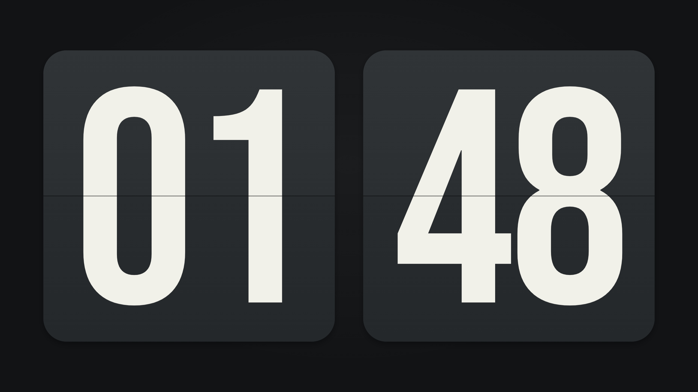
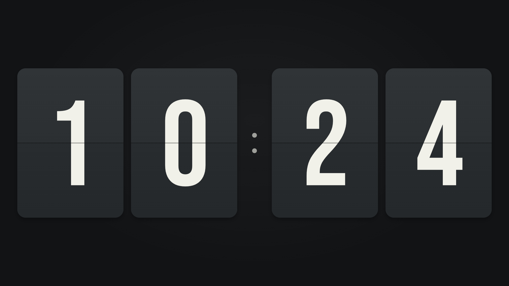
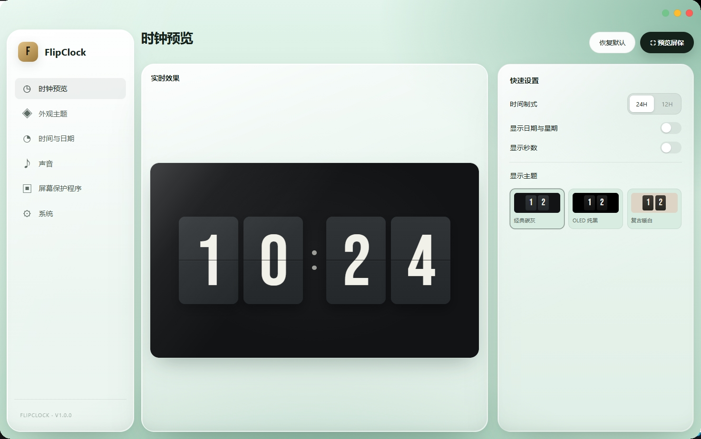
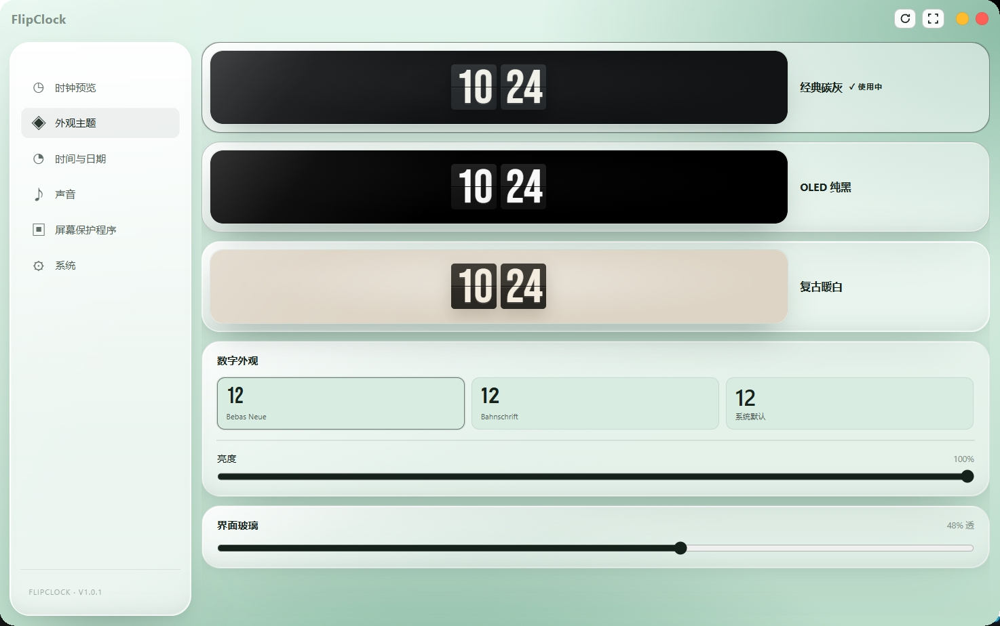
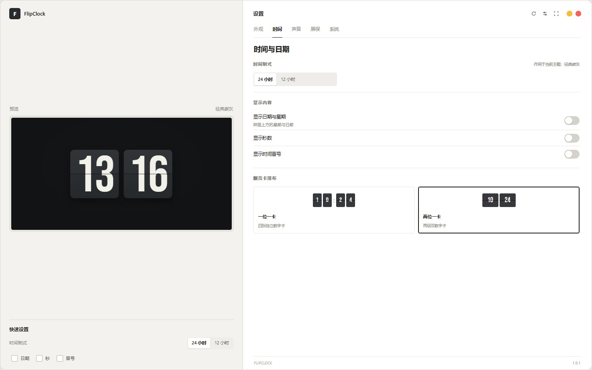

<p align="center"></p>
<h1 align="center">FlipClock 翻页时钟</h1>
<p align="center"><em>桌面上的机械翻页钟，也是一份真正的 Windows 屏幕保护程序。</em></p>
<p align="center"><a href="https://github.com/ShiXiongZhiDao/FlipClock/blob/main/README.md">English</a> · <strong>简体中文</strong></p>
<p align="center">
  
  
  
  
  
</p>

<p align="center"></p>

## 它能做什么

FlipClock 把 Windows 桌面变成一台机械翻页钟。每位数字住在一张带中缝的翻页卡里：上叶片折下、下叶片翻入，同时实时合成一声短促的机械响——不打包任何音频文件。

- 三套钟面主题：经典炭灰 / OLED 纯黑 / 复古暖白。
- 两种数字排布：一位一卡（四张竖卡）或两位一卡（两张方卡）。翻页时序与音效完全相同，只改变分组方式。
- 24 / 12 小时制。12 小时制下小时补零（`09` 而不是 `9`），让两种排布保持对称。
- 日期行、秒数、分隔点（时分组之间的两个小圆点，俗称时间冒号）均可开关。
- 时钟缩放 50%–450%（默认 225%）、亮度 20%–100%（只压暗不提亮）、三款数字字体（Bebas Neue 随包 / Bahnschrift / 系统默认）。
- 可选主显示器或全部显示器；无参数启动可进设置窗口，也可直接全屏。
- 系统托盘：左键打开设置，右键菜单「打开设置 / 全屏时钟 / 开机自启 / 退出」。关闭设置窗口默认隐藏到托盘，真正退出只走托盘菜单。
- 可选开机自启（默认关）：登录后只驻留托盘、不弹窗；再次启动会唤起已有窗口，不会多开一个后台实例。
- 屏保组件（`.scr`）与主程序是字节级相同的二进制，可按当前用户安装，不需要管理员权限。

<p align="center"></p>

## 它不是什么

- **不是网页**：它是原生 Windows 应用，时钟界面在本地 WebView2 中运行。
- **不是闹钟、计时器或日历**：它只报时间，可选显示日期，不会响铃提醒。
- **不是锁屏替代品**：它是你在 Windows 屏保设置里选定的屏保，另有一个需要自己启动的全屏模式。
- **不是云服务**：没有账号、没有同步、没有遥测。唯一的外出请求是可选的更新检查。
- **不是跨平台软件**：仅支持 Windows 10/11 x64。Windows 系统预览钩子（`/p <HWND>`）明确不支持：进程不创建窗口直接退出。

## 为什么做这个

翻页钟好看，但桌面上的版本要么是个浏览器标签页（浏览器一关就没了），要么是个没有任何设置的屏保。这个项目想两者都是：同一个二进制既当普通应用跑，也当真正的 `.scr` 注册给 Windows。翻页声用 Web Audio API 生成，下载体积小、运行时不抓任何资源。所有外观选项集中在一个设置窗口里，改完即时生效。

## 和常见做法比一比

| | Windows 自带屏保 | 网页时钟 | FlipClock |
| --- | --- | --- | --- |
| Windows 锁屏时运行 | 是 | 否 | 是，作为真正的 `.scr` |
| 需要浏览器或标签页 | 否 | 是 | 否 |
| 机械翻页动画 | 否 | 看网站 | 是，四层 CSS 3D 叶片 |
| 翻页音效 | 否 | 通常静音 | 每次显示变化时合成 |
| 主题 / 排布 / 字体 / 亮度 | 否 | 看网站 | 是，都在设置里 |
| 离线可用 | 是 | 通常否 | 是，更新检查除外 |
| 需要管理员权限 | 否 | 否 | 否，按当前用户安装 |

## 界面长什么样

上面两张全屏图是两种数字排布。**v1.0.0 的设置界面为中文**；下面几张图只为说明有哪些可调项，英文界面计划在后续版本提供。

| 时钟预览 | 外观主题 |
| --- | --- |
|  |  |

| 时间与日期 | 全屏时钟 |
| --- | --- |
|  |  |

## 隐私与边界

- FlipClock 完全本地运行，没有账号体系、没有统计、没有遥测。
- 唯一的外出请求是「系统 → 关于」里**由你主动触发**的更新检查：先问 Gitee，再问 GitHub；不点检查就不会发请求。
- 更新包用 minisign 签名，安装器验签后才应用更新。
- 设置按用户存储；屏保组件也按当前用户安装，从不碰 `System32`。
- 时钟不访问摄像头、麦克风、文件内容或剪贴板。

## 怎么装

到 <https://github.com/ShiXiongZhiDao/FlipClock/releases> 下载。

- **安装版**：`FlipClock_<版本>_x64-setup.exe`。按当前用户安装，不需要管理员权限。应用内「系统 → 关于」可检查并安装更新。
- **便携版**：`FlipClock_<版本>_x64-portable.zip`，解压即用。能检查更新，但没有安装器可执行更新，新版本要手动下载。
- **国内镜像**：<https://gitee.com/ShiXiongZhiDao/FlipClock/releases>，同步同样的 Release 附件。

要当屏保用，打开设置 → 「屏幕保护程序」→「安装并设为当前屏保」。组件会复制到应用旁边并注册给当前用户；随时可以在同一页恢复成安装前的屏保。

命令行：

| 参数 | 作用 |
| --- | --- |
| *无参数* | 按设置里的「无参数启动策略」进入设置窗口或全屏时钟。 |
| `/c` | 打开设置窗口。 |
| `/s` | 以屏保启动，任意输入退出。 |
| `/p <HWND>` | 不支持——不创建窗口直接退出。 |

## 常见问题

**`.scr` 真的是同一个程序吗？**
是。`FlipClock.scr` 与 `FlipClock.exe` 字节级相同，只有文件名不同；Windows 根据扩展名和参数决定怎么启动它。

**需要管理员权限吗？**
不需要。屏保组件与开机自启项都写在当前用户的注册表位置。

**屏保页提示「版本不匹配」是怎么回事？**
已注册的 `.scr` 比你正在运行的应用旧。点「重新部署屏保组件」换成同版本的二进制即可。

**关了窗口托盘图标还在，是卡住了吗？**
不是。关闭设置窗口默认隐藏到托盘。左键托盘图标重新打开，右键 →「退出」才真正结束。此行为可在「系统」页关掉。

**能用多个显示器吗？**
可以。「屏幕保护程序」页提供主显示器 / 全部显示器两种策略；指定显示器子集暂不支持。

**12 小时制显示 `9` 还是 `09`？**
显示 `09`。12 小时制与 24 小时制都会补零，两种排布因此保持对称。

**开机自启会在登录时铺一个大钟面吗？**
不会。自启用 `--tray` 启动，只在托盘放一个图标。状态每次都从注册表读，所以你在任务管理器里禁用后，设置页也会同步反映。

**已经在运行时再打开一次 FlipClock 会怎样？**
已有窗口会被唤到前台，不会多开一个后台实例。屏保（`/s`）启动是例外，这样 Windows 随时都能拉起它。

**放得很大时钟面为什么会被裁掉？**
时钟缩放上限就是 450%。超过屏幕范围时卡片会如实伸出屏幕，而不是悄悄缩小——预览里看到的就是实际效果。

## 从源码构建

需要 Windows 10/11（含 WebView2）、Node.js 18+、pnpm 与稳定版 Rust 工具链。

```bash
pnpm install
pnpm build          # 前端类型检查与构建
pnpm tauri dev      # 开发
pnpm build:app      # release 构建，前端内嵌进二进制
pnpm scr            # 复制为 dist-scr/FlipClock.exe 与 FlipClock.scr
```

不要用裸 `cargo build --release`：缺 `custom-protocol` 特性时前端不会被内嵌，双击只会看到「localhost 拒绝连接」。构建安装包还需要 `TAURI_SIGNING_PRIVATE_KEY`，因为更新包必须签名。

版本变化见 [CHANGELOG.md](./CHANGELOG.md)，依赖与字体归属见 [THIRD_PARTY_NOTICES.md](./THIRD_PARTY_NOTICES.md)。

## 许可

GNU GPL v3.0，见 [LICENSE](./LICENSE)。随包的 Bebas Neue 字体按 SIL Open Font License 分发，见 `src/assets/fonts/OFL.txt` 与 [THIRD_PARTY_NOTICES.md](./THIRD_PARTY_NOTICES.md)。

## ☕ 赞助作者

如果 FlipClock 让你的桌面好看了一点，可以请作者喝杯咖啡——这类小工具就靠这个继续做下去。
下面的收款码从公开图片仓库加载，不随安装包分发。

| 支付宝 | 微信支付 |
| --- | --- |
|  |  |

## 📮 联系

- 个人主页：[shixiongzhidao.cn](https://shixiongzhidao.cn)
- 开源项目：[github.com/ShiXiongZhiDao](https://github.com/ShiXiongZhiDao)
- 问题反馈：[GitHub Issues](https://github.com/ShiXiongZhiDao/FlipClock/issues)
- 微信公众号：**师兄知道**——软件里「系统 → 关于作者」展示的是同一个。


