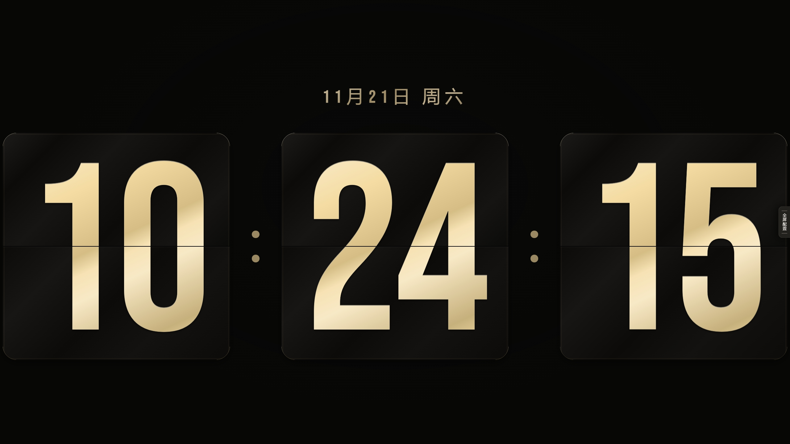

<p align="center"></p>
<h1 align="center">FlipClock 翻页时钟</h1>
<p align="center"><em>桌面上的机械翻页钟，也是一份真正的 Windows 屏幕保护程序。</em></p>
<p align="center"><a href="https://github.com/ShiXiongZhiDao/FlipClock/blob/main/README.md">English</a> · <strong>简体中文</strong></p>
<p align="center">
  
  
  
  
  
</p>

<p align="center"></p>

## 下载

Windows 10/11 x64。二选一：

| 形态 | 文件 | 说明 |
| --- | --- | --- |
| 安装版 | [`FlipClock_1.1.1_x64-setup.exe`](https://github.com/ShiXiongZhiDao/FlipClock/releases/download/v1.1.1/FlipClock_1.1.1_x64-setup.exe) | 按当前用户安装，不需要管理员权限；应用内更新 |
| 便携版 | [`FlipClock_1.1.1_x64-portable.zip`](https://github.com/ShiXiongZhiDao/FlipClock/releases/download/v1.1.1/FlipClock_1.1.1_x64-portable.zip) | 解压即用；新版本要手动下载 |

[GitHub Releases](https://github.com/ShiXiongZhiDao/FlipClock/releases) ·
[Gitee 镜像](https://gitee.com/ShiXiongZhiDao/FlipClock/releases)

WebView2 随 Windows 10/11 提供；缺失时安装器会拉取。

## 它是什么

FlipClock 是 Windows 桌面上的机械翻页钟，**也是**真正注册到 Windows 的 `.scr` 屏幕保护
程序——同一个二进制两者都能当。翻页动画与音效实时合成，不打包音频文件。

## 核心特点

- **主题** — 五个内置主题，每个自带一套钟面配置；自定义主题由六个部件组成，可选哑光 /
  金属 / 柔光材质，支持背景图与数字纹理。
- **钟面** — 一位一卡或两位一卡，24/12 小时制，日期、秒、分隔点可开关；缩放、亮度、
  钟面字体可调。
- **编辑** — 双击钟面进入全屏配置：右边改参数，左边看效果。「保存」一次写入，「放弃」
  全部回滚。
- **窗口** — 两栏设置，左侧常驻预览。界面语言与界面外观（跟随系统 / 浅 / 深）和钟面
  是两条独立的轴。
- **配置包** — 「系统」页可导出主题、字体与偏好；导入时勾选要恢复的内容，自定义主题与
  字体按合并处理，不会删除。
- **运行** — 托盘常驻、开机自启、主屏或全部显示器。同一二进制按当前用户注册为 `.scr`，
  不需要管理员权限。

## 界面截图

黑标典藏金（开启秒数与日期）、背景图加数字纹理的自定义主题、设置窗口，以及全屏配置抽屉。

<p align="center"></p>
<p align="center"></p>

| 设置窗口 · 浅色外观 | 设置窗口 · 深色外观 |
| --- | --- |
|  |  |

| 全屏配置 · 浅色抽屉 | 全屏配置 · 深色抽屉 |
| --- | --- |
|  |  |

界面语言可跟随系统，也可设为中文或英文；这几张设置截图是中文界面。外壳明暗不碰钟面，
钟面由主题决定。

## 快速开始

1. **安装** — 运行安装包（或解压便携版），打开 FlipClock。
2. **调成你的样子** — 在「外观」选主题，在「时间与日期」设制式、日期、秒数与翻页卡排布。
   改动即时保存。
3. **当屏保用** — 「设置 → 屏保 → 安装并设为当前屏保」，然后到 Windows 里设等待时间。

关闭设置窗口默认隐藏到托盘；右键托盘图标 →「退出」才真正结束。

完整步骤：[快速开始](./docs/guide/zh-CN/quick-start.md) ·
[屏幕保护程序](./docs/guide/zh-CN/screensaver.md)。

## 适用范围与限制

- **仅 Windows 10/11 x64。** 没有 macOS、Linux 或 Windows ARM 版本。
- **需要 WebView2。** Windows 10/11 自带；缺失时安装器会拉取。
- **不需要管理员权限。** 应用按当前用户装到 `%LOCALAPPDATA%\FlipClock`，屏保也注册在
  当前用户下。
- **显示器：** 屏保覆盖主显示器或全部显示器，不支持指定显示器子集。
- **系统预览：** `/p <HWND>` 钩子不支持，进程不建窗口直接退出。
- **不是锁屏替代品、闹钟、计时器、日历或云服务。** 没有账号，也没有同步。
- **便携版不能就地升级。** 新版本要重新下载 zip。

## 隐私

- **不收集个人隐私数据。** 没有账号，不收集姓名或邮箱，没有设备或安装标识，也不读取
  文件、剪贴板、摄像头或麦克风。
- **匿名使用统计。** 官方构建会发送五类匿名事件（启动、配置快照、打开设置、切换功能、
  检查更新）到 Aptabase。不发送自由文本，没有持久标识，应用内没有开关。源码自建且未配置
  app key 时一条也不发。
- **网络请求。** 设置窗口出现后会检查一次更新，关于页会加载三张图片。没有同步。
- **本地数据。** 设置、主题、字体与导入的图片都在 `%APPDATA%\com.dd.shixiongzhidao\`；
  导入的文件会复制进去。

完整说明：[隐私说明](./docs/guide/zh-CN/privacy.md)。

## 常见问题与文档

**`.scr` 真的是同一个程序吗？**
是。`FlipClock.scr` 与 `FlipClock.exe` 字节级相同；Windows 根据扩展名和参数决定怎么启动它。

**需要管理员权限吗？**
不需要。屏保与开机自启都注册在当前用户下。

**关了窗口托盘图标还在，是卡住了吗？**
不是。关闭设置窗口默认隐藏到托盘。右键图标 →「退出」才真正结束，也可以在
「系统 → 启动与窗口」里关掉这个行为。

**屏保页提示「版本不匹配」是怎么回事？**
已注册的 `.scr` 比你正在运行的应用旧。先关掉屏保，再点「重新部署屏保组件」。

**换机器怎么带走主题和字体？**
在「系统」页导出配置包，到新机器导入并勾选要恢复的内容。自定义主题与字体合并，
偏好则覆盖。

指南：[快速开始](./docs/guide/zh-CN/quick-start.md) ·
[屏幕保护程序](./docs/guide/zh-CN/screensaver.md) ·
[主题与字体](./docs/guide/zh-CN/themes-and-fonts.md) ·
[备份与迁移](./docs/guide/zh-CN/backup-and-restore.md) ·
[隐私说明](./docs/guide/zh-CN/privacy.md) ·
[故障排查](./docs/guide/zh-CN/troubleshooting.md) ·
[全部指南](./docs/guide/zh-CN/README.md)。

## 从源码构建

需要 Windows 10/11（含 WebView2）、Node.js 18+、pnpm 与稳定版 Rust 工具链。

```bash
pnpm install
pnpm build          # 前端类型检查与构建
pnpm tauri dev      # 开发
pnpm build:app      # release 构建，前端内嵌进二进制
pnpm scr            # 复制为 dist-scr/FlipClock.exe 与 FlipClock.scr
```

不要用裸 `cargo build --release`：缺 `custom-protocol` 特性时前端不会被内嵌，双击只会看到
「localhost 拒绝连接」。构建安装包还需要 `TAURI_SIGNING_PRIVATE_KEY`，因为更新包必须签名。

## 许可与鸣谢

GNU GPL v3.0，见 [LICENSE](./LICENSE)。随包的 Bebas Neue 字体按 SIL Open Font License
分发，见 `src/assets/fonts/OFL.txt`；字体与依赖归属见
[THIRD_PARTY_NOTICES.md](./THIRD_PARTY_NOTICES.md)。

## ☕ 赞助作者

如果 FlipClock 让你的桌面好看了一点，可以请作者喝杯咖啡——这类小工具就靠这个继续做下去。
下面的收款码从公开图片仓库加载，不随安装包分发。

| 支付宝 | 微信支付 |
| --- | --- |
|  |  |

## 📮 联系

- 个人主页：[shixiongzhidao.cn](https://shixiongzhidao.cn)
- 开源项目：[github.com/ShiXiongZhiDao](https://github.com/ShiXiongZhiDao)
- 问题反馈：[GitHub Issues](https://github.com/ShiXiongZhiDao/FlipClock/issues)
- 微信公众号：**师兄知道**——软件里「系统 → 关于」展示的是同一个。


