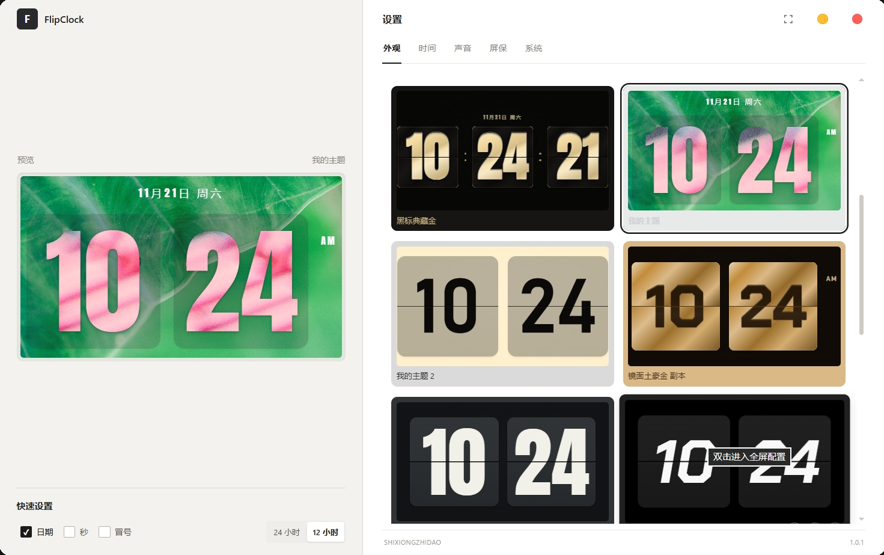

# Quick start

English · [简体中文](../zh-CN/quick-start.md)

This page takes you from download to a working clock. It assumes Windows 10 or 11 on x64.

## 1. Choose the right download

| Build | File | Install | Updates |
| --- | --- | --- | --- |
| Installed | `FlipClock_<version>_x64-setup.exe` | Per user, no administrator rights | In-app: **System → About → Check for updates** |
| Portable | `FlipClock_<version>_x64-portable.zip` | Unzip anywhere and run `FlipClock.exe` | Can check, but has no installer — download new versions manually |

Downloads: [GitHub Releases](https://github.com/ShiXiongZhiDao/FlipClock/releases) ·
[Gitee mirror](https://gitee.com/ShiXiongZhiDao/FlipClock/releases).

The installed build goes to `%LOCALAPPDATA%\FlipClock`. WebView2 is included with
Windows 10/11; if it is missing, the installer fetches it.

## 2. Open it

Double-click `FlipClock.exe` (or the Start menu entry). By default the Settings window
opens. If **System → Startup & Window → No-argument launch** is set to **Full-screen clock**,
the clock opens instead.

Closing the Settings window closes it; the app stays in the system tray and keeps running.
Right-click the tray icon → **Quit** to exit.

## 3. Pick a theme and clock face

The Settings window has a permanent preview on the left and five tabs on the right.

- **Appearance** — the theme wall, **New theme**, clock font, scale, brightness.
- **Time & Date** — 24/12-hour, date line, seconds, separator dots, one or two digits per card.
- **Sound** — flip sound and volume (only audible in the full-screen clock and the screen saver).
- **Saver** — install and manage the Windows screen saver.
- **System** — autostart, stay in the tray when closing, no-argument launch, language, UI appearance,
  config bundle, reset, updates, About.

Changes preview immediately and are written as you go; the Settings window has no Save button.

## 4. Quit or keep it in the tray

- Close button: closes the window and keeps the app in the tray by default.
- **System → Startup & Window → Keep the app in the system tray when closing the window**: turn it
  off if you want the close button to exit the app.
- **System → Startup & Window → Autostart**: starts with Windows, tray only, no window.

## Next

- [Use it as a screen saver](screensaver.md)
- [Themes and fonts](themes-and-fonts.md)
- [Move your setup to another PC](backup-and-restore.md)
