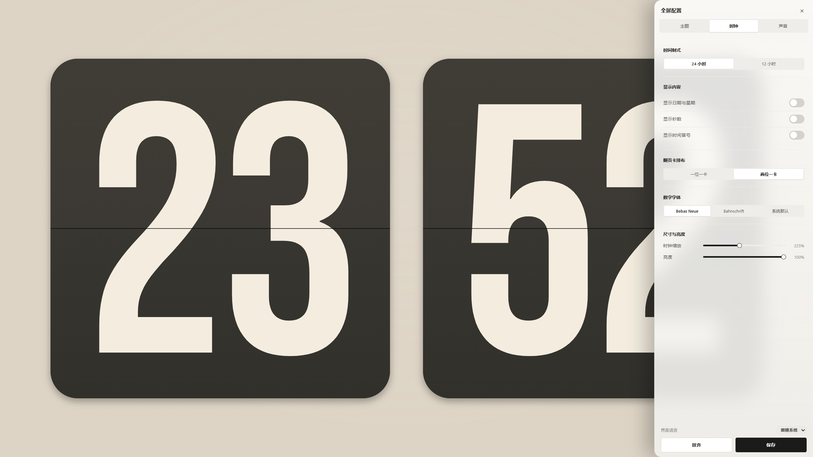
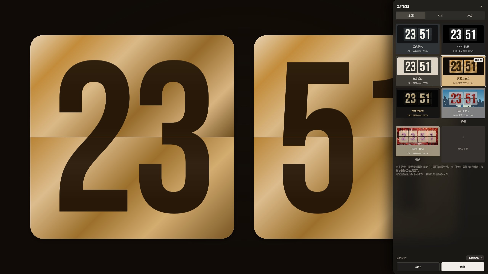
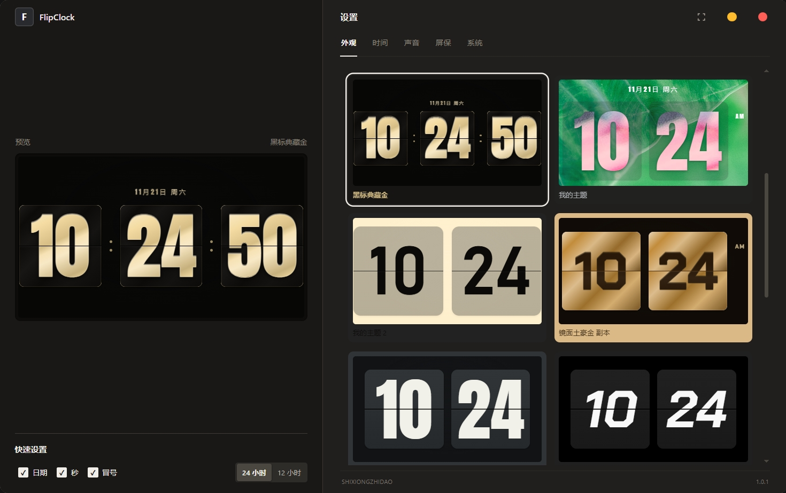

# Themes and fonts

English · [简体中文](../zh-CN/themes-and-fonts.md)

## A theme is the whole clock face

FlipClock ships with five themes:

- **Classic Carbon Gray**
- **OLED True Black**
- **Retro Warm White**
- **Mirror Gold**
- **Black Label Gold**

A theme carries its own clock profile: time format, date line, seconds, separator dots,
digit layout, clock font, scale, brightness, flip sound, and volume. Switching the theme
switches all of it.

Built-in theme appearance is locked. To change one, **copy** it first; the copy becomes a
custom theme.

## Custom themes

Create one with **Appearance → New theme**, or copy an existing card. The limit is 36
custom themes; names are up to 16 characters.

A theme is built from six parts:

| Part | What you can change |
| --- | --- |
| Background | Colour; optional image; Cover or Tile; Dim 0–70%; opacity |
| Card | Colour; material; edge colour for metallic; opacity |
| Digits | Colour; material; optional texture image; opacity |
| Date line | Colour; opacity |
| Card seam | Colour; opacity |
| Separator dots | Colour; opacity (the on/off switch lives in the clock profile) |

Materials are **Matte**, **Metallic**, and **Soft**. Material decides how light and shadow
are distributed; colour only sets the hue. Metallic parts also get an edge colour, which can
follow the main colour.

Background and texture images can be `png`, `jpg`, `jpeg`, or `webp`. They are copied into
the configuration directory, so moving or deleting the originals later does not break the
theme. If digits and cards are below 3:1 contrast, the editor shows a warning but still
lets you save.

| Light UI | Dark UI |
| --- | --- |
|  |  |

## Fonts

Built-in clock fonts: **Bebas Neue**, **Bahnschrift**, **System default**.

You can import local fonts with **Appearance → Clock font → Import font…**:

- Formats: `ttf`, `otf`, `woff`, `woff2`. The file content is checked, not the extension.
- Limits: 32 MB per file, 32 imported fonts, 32 characters per name.
- Imported fonts are copied to the configuration directory and only used by FlipClock.
- Deleting a font makes every theme that used it fall back to **Bebas Neue**.
- The clock font applies to digits, the date line, and the AM/PM badge — not to the Settings UI.

## Full-screen setup

Double-click the preview clock on the left, or a theme card's **Edit** button. The setup
fills the screen: change values in the drawer while watching the clock.

- **Save** writes once and closes.
- **Discard** rolls back every change made in this session.
- Pressing Esc with unsaved changes asks whether to save, discard, or keep editing.

The same window can create a theme. Copying and deleting themes stay in the Settings page.

## UI appearance is not a theme

**UI appearance** (System → UI Appearance) changes only the Settings window and the
full-screen setup drawer: **Follow System**, **Light**, or **Dark**. It never changes the
clock face. The clock face is decided by the theme.

## Where the files live

Everything is under `%APPDATA%\com.dd.shixiongzhidao\`:

- `settings.json` — preferences and theme definitions
- `themes\<theme-id>\` — imported background and texture images
- `fonts\` — imported font files
