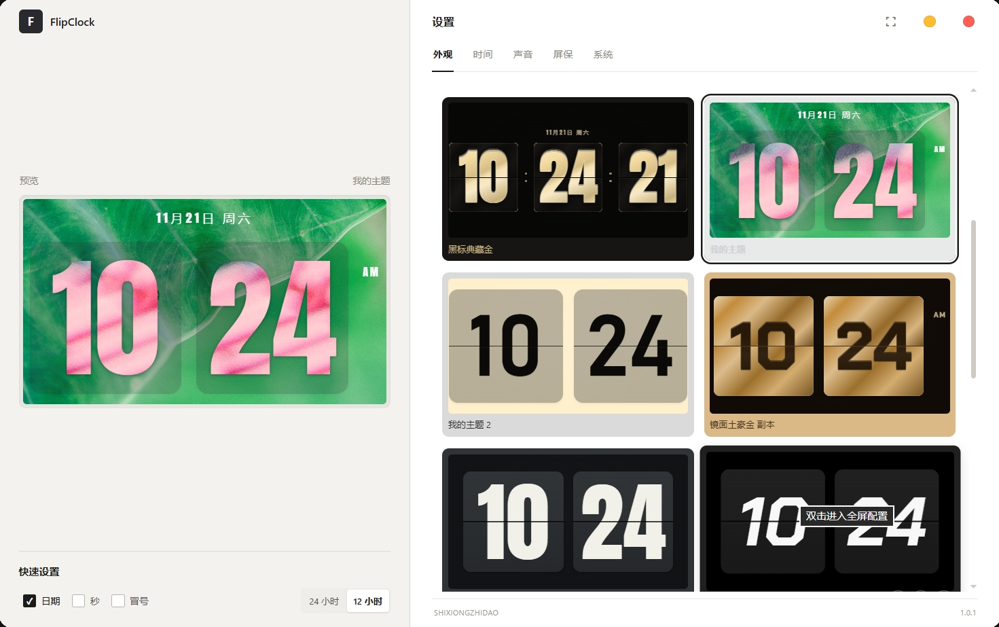

# 快速开始

简体中文 · [English](../en/quick-start.md)

从下载到看见时钟。以下假定系统是 Windows 10 或 11 x64。

## 1. 选对安装包

| 形态 | 文件 | 安装方式 | 更新 |
| --- | --- | --- | --- |
| 安装版 | `FlipClock_<版本>_x64-setup.exe` | 按当前用户安装，不需要管理员权限 | 应用内「系统 → 关于 → 检查更新」 |
| 便携版 | `FlipClock_<版本>_x64-portable.zip` | 解压即用，运行 `FlipClock.exe` | 能检查，但没有安装器，新版本要手动下载 |

下载地址：[GitHub Releases](https://github.com/ShiXiongZhiDao/FlipClock/releases) ·
[Gitee 镜像](https://gitee.com/ShiXiongZhiDao/FlipClock/releases)。

安装版装在 `%LOCALAPPDATA%\FlipClock`。WebView2 随 Windows 10/11 提供；缺失时安装器会拉取。

## 2. 打开它

双击 `FlipClock.exe` 或开始菜单里的条目。默认打开设置窗口；如果「系统 → 启动与窗口 →
无参数启动」选的是「全屏时钟」，则会直接铺满屏幕。

关闭设置窗口默认只是隐藏到系统托盘，程序还在运行。右键托盘图标 →「退出」才真正结束。

## 3. 选主题和钟面

设置窗口左侧是常驻预览，右侧是五个页签。

- **外观** —— 主题墙、新建主题、钟面字体、缩放、亮度。
- **时间与日期** —— 24/12 小时制、日期行、秒数、时间冒号、一位一卡或两位一卡。
- **声音** —— 翻页音效与音量（只在全屏时钟和屏保里发声）。
- **屏保** —— 安装与管理 Windows 屏幕保护程序。
- **系统** —— 开机自启、关闭到托盘、无参数启动、界面语言、界面外观、配置迁移、恢复默认、更新、关于。

改动即时预览并自动写入；设置窗口没有「保存」按钮。

## 4. 退出或留在托盘

- 关闭按钮：默认隐藏到托盘。
- **系统 → 启动与窗口 → 关闭窗口时最小化到托盘**：关掉它，点关闭就退出程序。
- **系统 → 启动与窗口 → 开机自启**：登录 Windows 后自动启动，只驻留托盘，不弹窗口。

## 接下来

- [当成屏幕保护程序用](screensaver.md)
- [主题与字体](themes-and-fonts.md)
- [把配置带到另一台电脑](backup-and-restore.md)
