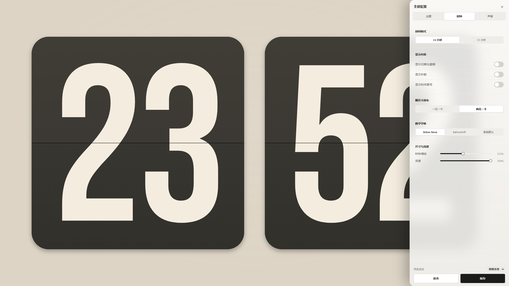
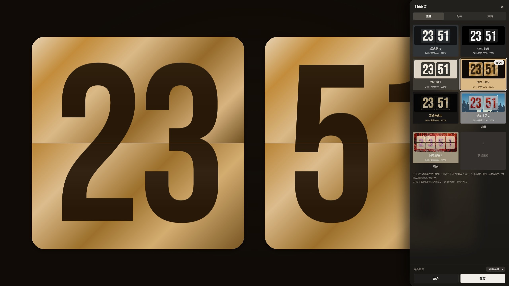
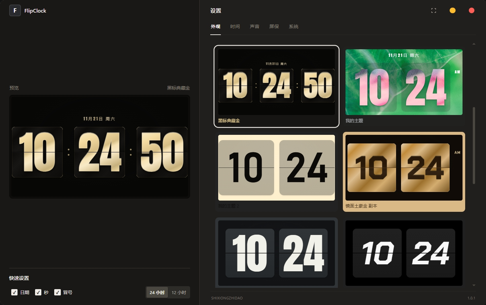

# 主题与字体

简体中文 · [English](../en/themes-and-fonts.md)

## 主题就是整套钟面

内置五个主题：

- **经典碳灰**
- **OLED 纯黑**
- **复古暖白**
- **镜面土豪金**
- **黑标典藏金**

每个主题自带一份钟面配置：时间制式、日期行、秒数、时间冒号、翻页卡排布、钟面字体、
缩放、亮度、翻页音效与音量。切换主题就是整套切换。

内置主题的外观是锁定的。想改，先**复制**一份，复制品成为自定义主题。

## 自定义主题

「外观 → 新建主题」创建，或在主题卡上复制。自定义主题上限 36 个，名字最多 16 个字符。

主题由六个部件组成：

| 部件 | 能改什么 |
| --- | --- |
| 背景 | 颜色；可选背景图；铺满或平铺；压暗 0–70%；不透明度 |
| 卡片 | 颜色；材质；金属材质时可改边线颜色；不透明度 |
| 数字 | 颜色；材质；可选数字纹理图；不透明度 |
| 日期 | 颜色；不透明度 |
| 翻页缝 | 颜色；不透明度 |
| 冒号 | 颜色；不透明度（显示开关在钟面配置里） |

材质三选一：**哑光**、**金属**、**柔光**。材质决定明暗怎么分布，颜色只决定色相。
金属部件多一个边线颜色，可以让它跟随主色。

背景图和数字纹理支持 `png`、`jpg`、`jpeg`、`webp`。选图时会复制进配置目录，之后移动或
删除原文件都不影响主题。数字与卡片的对比度低于 3:1 时编辑器会提醒，但仍然允许保存。

| 浅色抽屉 | 深色抽屉 |
| --- | --- |
|  |  |

## 字体

内置钟面字体：**Bebas Neue**、**Bahnschrift**、**系统默认**。

「外观 → 钟面字体 → 导入字体…」可以加入本机字体：

- 格式：`ttf`、`otf`、`woff`、`woff2`。按文件内容判定，不看扩展名。
- 限制：单文件 32 MB，最多 32 款，名称最多 32 个字符。
- 导入的字体会复制进配置目录，只在本机使用。
- 删除字体后，用过它的主题一律回退到 **Bebas Neue**。
- 钟面字体作用于数字、日期行和 AM/PM 徽标，不影响设置界面。

## 全屏配置

双击左栏预览钟面，或点主题卡的「编辑」。全屏配置会铺满整块屏幕：右边抽屉改参数，
左边实时看效果。

- 「保存」一次写入并关闭。
- 「放弃」回滚这次的全部改动。
- 有未保存改动时按 Esc，会问你要保存、放弃还是继续编辑。

同一个窗口也能新建主题；复制与删除仍在设置页。

## 界面外观不是主题

「系统 → 界面外观」只改设置窗口与全屏配置抽屉的明暗：**跟随系统**、**浅色**、**深色**。
它从不改变钟面。钟面由主题决定。

## 文件在哪

都在 `%APPDATA%\com.dd.shixiongzhidao\`：

- `settings.json` —— 偏好与主题定义
- `themes\<主题id>\` —— 导入的背景图与纹理图
- `fonts\` —— 导入的字体文件
